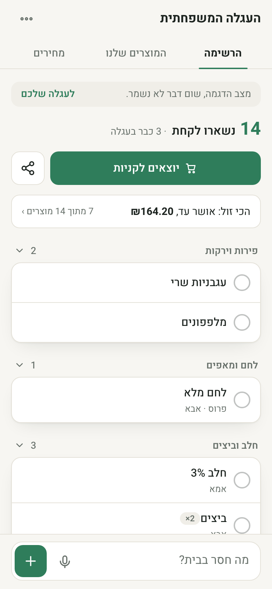
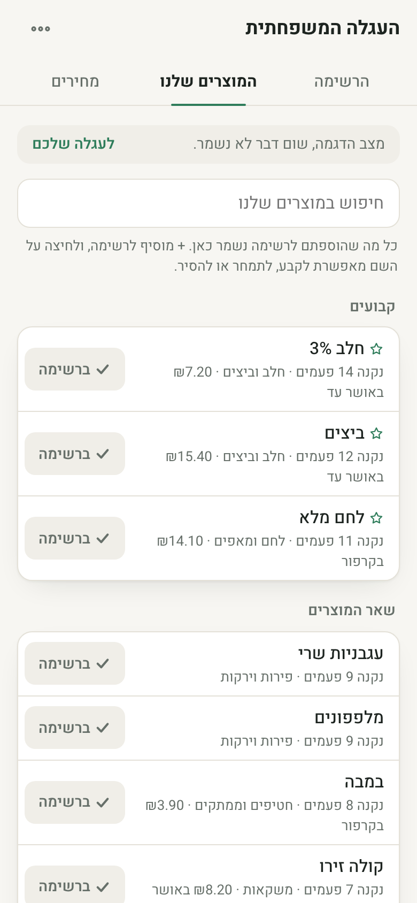
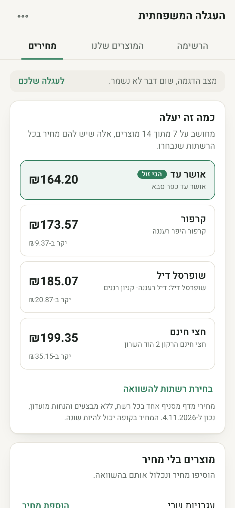
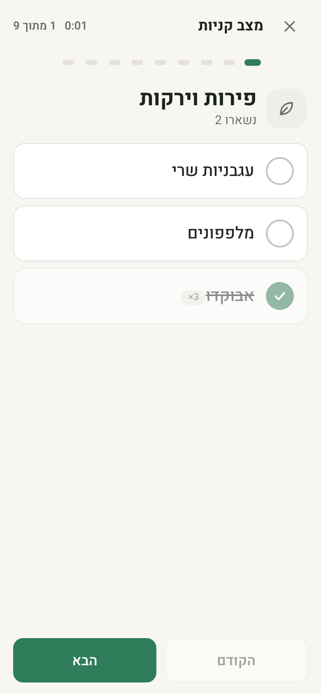
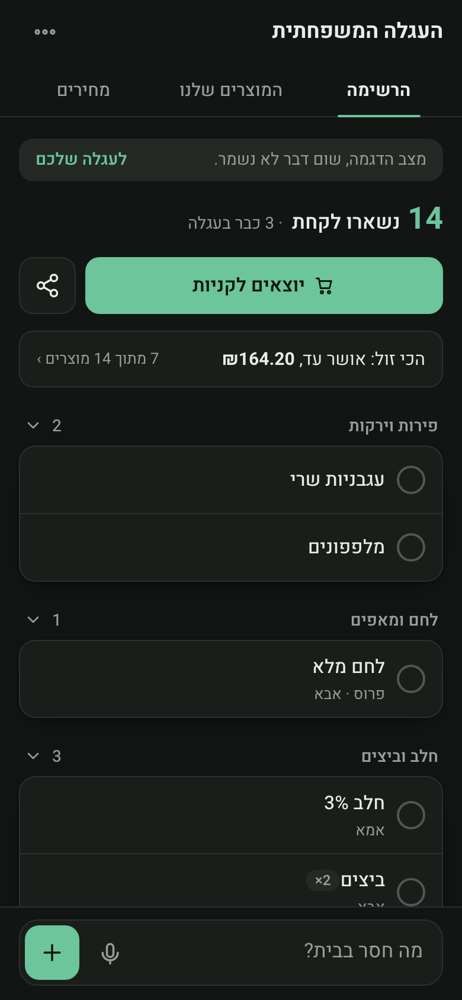
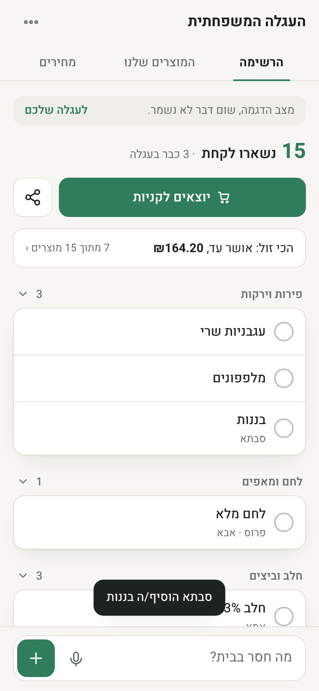

# Family Cart · העגלה המשפחתית

[](https://github.com/Idosiloni/family-cart/actions/workflows/ci.yml)  

**A shared family shopping list that sorts itself into supermarket aisles and syncs live between phones.** Hebrew-first, right-to-left, installable on a home screen, and built with no framework and no build step.

**Live app: https://family-cart-cf2cf.web.app** · **Try it without signing up: https://family-cart-cf2cf.web.app/#demo** (an in-memory cart, nothing is saved)



> **עברית, בקצרה:** רשימת קניות משפחתית משותפת. כותבים מה חסר, והמוצרים מתחלקים אוטומטית למחלקות בסופר. כולם במשפחה רואים שינויים בזמן אמת, בלי הרשמה: מי שפותח את אותו קישור רואה את אותה עגלה. שלוש לשוניות: הרשימה, המוצרים שלנו (מה שאנחנו קונים תמיד), ומחירים (כמה זה עולה בכל סופר).

## Why it exists

Family WhatsApp groups are where shopping lists go to die: items get buried, bought twice, or missed. This app keeps one list for the whole family, and the list is organised the way you actually walk the store.

## Features

- **Three quiet tabs.** *The list*, *our products* and *prices*. Settings (name, store order, connect devices, home screen, light/dark, colour) live behind one menu button. One accent colour, no gradients, no glow.
- **Live sync.** Everyone with the cart link sees changes instantly. When someone else adds an item while your screen is open, a toast says who added what.
- **Auto-sorting into supermarket sections.** A word-aware Hebrew classifier (with a catalog of Israeli products and brands) files each item under produce, dairy, bakery, and so on. Correct it once and the family's correction is remembered for every future item.
- **Our products.** Everything the family ever adds is counted and kept. Tap `+` to add it again, pin the weekly regulars and add them all in one tap, change a product's section, or remove it. While typing, matching regulars appear above the keyboard.
- **Prices and store comparison.** Real shelf prices for ~100 common products from the chains' public price files (see below), the estimated cost of your list at each chain, and the family's own prices on top. Plus **receipts**: type what you actually paid at a store and see the average per trip and per item.
- **Your store's order.** Move sections up or down to match how you walk your supermarket; the whole family sees the same order.
- **Shopping mode.** One section at a time, in walking order, with a progress strip, a trip timer, a screen that stays awake, and a summary at the end that compares with your last trip.
- **Fast input.** Type several items at once, paste a whole WhatsApp-style list, or dictate by voice. Quantities (`חלב x3`) and notes are parsed out.
- **Undo and swipe.** Tap the circle or swipe right to check an item off, swipe left to delete, tap the name to edit. Deleting can be undone from a toast.
- **Share the list.** Send what's left, grouped by section, to WhatsApp or the system share sheet.
- **Home screen.** A one-time banner and a settings entry walk each family member through "Add to home screen" (iOS and Android). The icon opens the exact cart: the manifest is built at runtime with the cart link as its start URL, and a small network-first service worker (never cache-first, so deploys are picked up at once) is registered. Install prompts depend on the browser; not yet verified on a real phone.

| List (light) | Our products | Prices | Shopping mode |
|---|---|---|---|
|  |  |  |  |

| List (dark) | Live update |
|---|---|
|  |  |

## Where the prices come from

Israeli law makes the big chains publish a price file per branch. `scripts/build-prices.mjs` downloads the public ones, takes a curated list of ~100 branded, fixed-size products (`scripts/reference-products.mjs`, matched by barcode), and writes the small `public/prices.json` the app loads.

- **Chains with data today:** Shufersal Deal (Ra'anana), Carrefour Hyper (Ra'anana), Hazi Hinam (Hod HaSharon) and Osher Ad (Kfar Saba). The branch and the date are shown in the app. These are **shelf prices of one branch, without club discounts or promotions**, so the register can differ.
- **Osher Ad is loaded from a file a person downloaded**, not fetched by the script, because its files sit behind a login and the builder never logs in anywhere. Download the branch's `PriceFull` file yourself (for example with the open-source [israeli-supermarket-scarpers](https://github.com/OpenIsraeliSupermarkets/israeli-supermarket-scarpers)) and pass it with `--osherad <file>`.
- **Rami Levy, Yochananof, Victory** are not included for the same reason (or could not be fetched automatically). Add any chain in the app and type its prices yourself; your prices always win over the file prices.
- **The comparison is fair by construction:** a chain's total only counts items that have a price at *every* compared chain, and the rest are listed as "no price". A chain with gaps can never look cheapest.
- **Refresh the data:** `node scripts/build-prices.mjs --fetch --cache /tmp/price-files --osherad <PriceFull file>` (Node 22, no dependencies; leave out `--osherad` to build without it). Shufersal's download links are signed and expire, so the script re-reads the listing every run.
- `public/stores.js` is a research directory of 11 chains with sources and three dated surveys. It deliberately has no price index: surveys use different baskets and dates.

## How it works

| Piece | What it does |
|---|---|
| **No build step** | Plain ES modules served from `public/`. Open it with any static server. |
| **Firestore** | One collection per cart: `carts/{id}/items` and `carts/{id}/receipts`, plus `settings/{prefs,learned,history,prices,stores}` for store order and theme, learned section corrections, "our products" (counts, pins), the family's own prices, and the chains being compared. |
| **Access model** | The cart is the 128-bit random id in the URL hash (`#<32 hex>`). There are no accounts. See [Security](#security-model). |
| **Classifier** | `categories.js` + `catalog*.js`: longest-keyword-wins matching that is word-aware, not substring (`מים` must be a whole word; `עגבני` matches the start of a word), plus brand names and per-family overrides. |
| **Parsing** | `parse.js` splits pasted or spoken text into items and pulls out quantities. |
| **Data layer** | `db.js` re-exports the Firestore calls the app uses. Open the page as `#demo` and it swaps in `demo-store.js`, an in-memory fake with the same surface, so the app can be demoed, screenshotted and tested with no backend. |
| **Rendering** | Hand-written DOM updates with a light FLIP animation for moving rows; an SVG icon set (`icons.js`) instead of emoji. |
| **Prices** | `pricing.js` is pure and tested: conservative product matching and the all-chains-priced comparison. `ui-prices.js` and `ui-regulars.js` are only screens. |

## Run it locally

```bash
git clone <this repo>
cd family-cart/public
python3 -m http.server 8000
```

Open http://localhost:8000/#demo to use it immediately with sample data and no Firebase.

To run against your own backend:

1. Create a Firebase project with Firestore and Hosting.
2. Put your web-app config in `public/firebase-config.js` and your project id in `.firebaserc`.
3. Deploy: `npx firebase-tools deploy` (publishes `public/` and `firestore.rules`).

Run the tests (Node 22+, no dependencies to install):

```bash
npm test
```

Regenerate the README screenshots (headless Chrome, uses demo mode):

```bash
node scripts/screenshots.mjs docs
```

## Security model

- A cart is reachable only by knowing its id. The id is 128 bits of `crypto.getRandomValues`, the `carts` collection cannot be listed, and the rules only allow reads and writes under a path whose id is at least 16 characters. Ids cannot be enumerated or guessed.
- `firestore.rules` also validates every write: allowed fields only, string and number length limits, quantity 1-99, and new items must start unchecked.
- The Firebase `apiKey` in `firebase-config.js` is public by design; the rules are what protect the data.

**Honest limits:** anyone who has the link can read and change that cart, exactly like a shared Google Doc link, so treat the link as the password. There is no per-user identity (the "who added this" name is self-declared), and no rate limiting beyond Firebase defaults.

## Project layout

```
public/
  index.html        markup and dialogs
  style.css         design tokens (light/dark, one accent), layout
  app.js            list, shopping mode, settings, realtime listeners
  ui-regulars.js    the "our products" tab
  ui-prices.js      the prices tab, price/receipt/chain dialogs
  regulars.js       pure: regulars, starters, quick-add suggestions
  pricing.js        pure: product matching, store comparison, receipt stats
  prices.json       generated shelf prices (see "Where the prices come from")
  stores.js         research directory of chains and dated surveys
  sw.js             network-first service worker (installability)
  db.js             real Firestore or the in-memory demo store
  demo-store.js     the demo fake and its sample family list
  categories.js     supermarket sections and the classifier
  catalog*.js       product and brand dictionaries (Israeli market)
  parse.js          item, quantity and spoken-list parsing
  format.js         pure text helpers: share text, timer
  effects.js        toast and reduced-motion helper
  swipe.js          swipe-to-check / swipe-to-delete gesture
  icons.js          SVG icon set
scripts/            price-data builder, README screenshot generator
test/               node:test unit tests (classifier, parser, text helpers, demo store, regulars, pricing)
.github/workflows   CI: runs the tests on every push and pull request
firestore.rules     validation and access rules (items, receipts, settings docs)
```

## Roadmap

- More chains in the price data (Victory's portal needs more reverse-engineering; the login-only chains stay manual)
- A scheduled job to refresh `prices.json`, and produce/weighted items
- Offline lists (Firestore persistence), and test the Firestore rules with the emulator
- English interface (the classifier is Hebrew-specific, so this needs its own catalog)

## License

[MIT](LICENSE)
