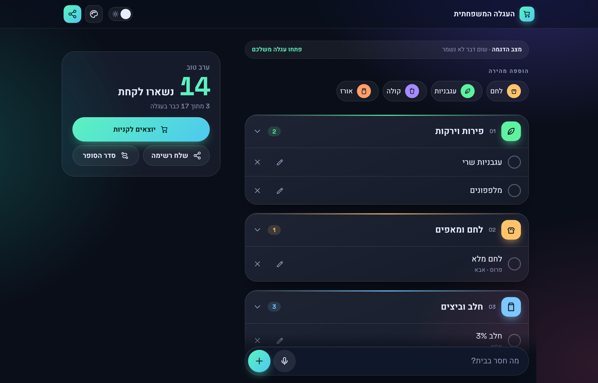
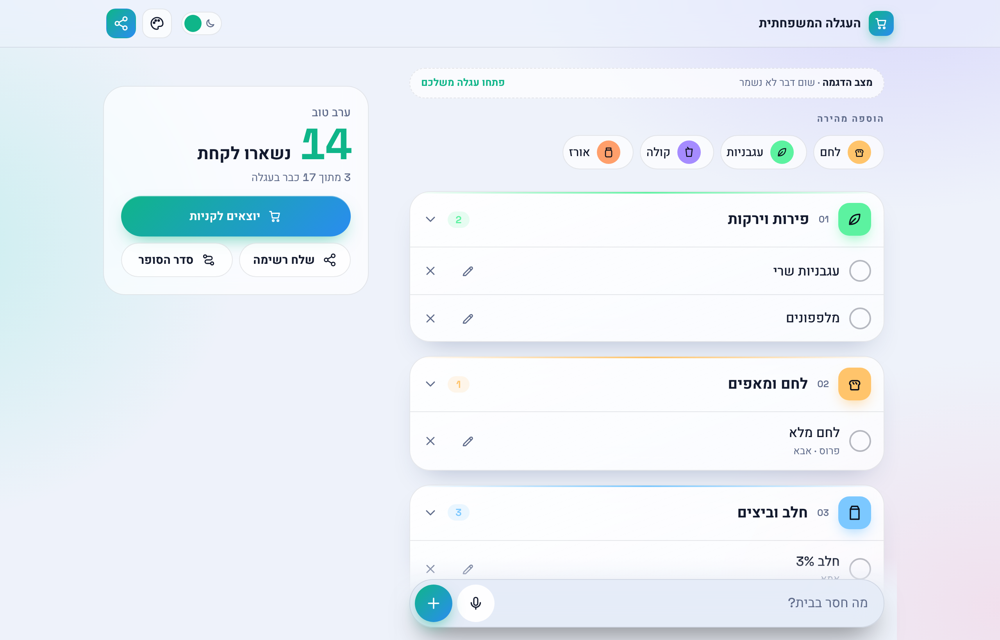
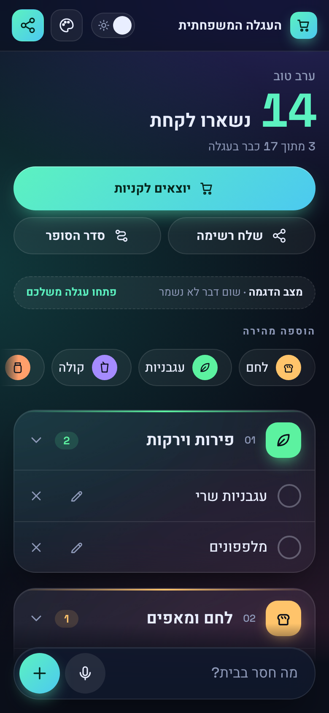

# Family Cart · העגלה המשפחתית

**A shared family shopping list that sorts itself into supermarket aisles and syncs live between phones.** Hebrew-first, right-to-left, installable on a home screen, and built with no framework and no build step.

**Live app: https://family-cart-cf2cf.web.app** · **Try it without signing up: https://family-cart-cf2cf.web.app/#demo** (an in-memory cart, nothing is saved)



> **עברית, בקצרה:** רשימת קניות משפחתית משותפת. כותבים מה חסר, והמוצרים מתחלקים אוטומטית למחלקות בסופר. כולם במשפחה רואים שינויים בזמן אמת, בלי הרשמה: מי שפותח את אותו קישור רואה את אותה עגלה.

## Why it exists

Family WhatsApp groups are where shopping lists go to die: items get buried, bought twice, or missed. This app keeps one list for the whole family, and the list is organised the way you actually walk the store.

## Features

- **Live sync.** Everyone with the cart link sees changes instantly. When someone else adds an item while your screen is open, a toast says who added what.
- **Auto-sorting into supermarket sections.** A word-aware Hebrew classifier (with a catalog of Israeli products and brands) files each item under produce, dairy, bakery, and so on. Correct it once and the family's correction is remembered for every future item.
- **Your store's order.** Move sections up or down to match how you walk your supermarket; the whole family sees the same order.
- **Shopping mode.** One section at a time, in walking order, with a progress strip, a trip timer, a screen that stays awake, and a summary at the end that compares with your last trip.
- **Fast input.** Type several items at once, paste a whole WhatsApp-style list, or dictate by voice. Quantities (`חלב x3`) and notes are parsed out. Quick-add chips learn what the family buys most.
- **Undo and swipe.** Deleting an item, or clearing everything already in the cart, can be undone from a toast. Rows can be swiped, and shopping mode rows too.
- **Share the list.** Send what's left, grouped by section, to WhatsApp or the system share sheet.
- **Connect devices.** A QR code and a WhatsApp link to join the same cart from another phone.
- **Installable.** "Add to home screen" opens the exact cart, via a manifest generated at runtime.
- **Polish.** Dark and light mode, five colour themes shared per cart, FLIP animations when items move, `prefers-reduced-motion` respected, 44px touch targets, keyboard focus kept after check-off.

| Light mode | Mobile | Shopping mode | Live update |
|---|---|---|---|
|  |  |  |  |

## How it works

| Piece | What it does |
|---|---|
| **No build step** | Plain ES modules served from `public/`. Open it with any static server. |
| **Firestore** | One collection per cart: `carts/{id}/items`, plus `settings/{prefs,learned,history}` for store order and theme, learned section corrections, and quick-add counts. |
| **Access model** | The cart is the 128-bit random id in the URL hash (`#<32 hex>`). There are no accounts. See [Security](#security-model). |
| **Classifier** | `categories.js` + `catalog*.js`: longest-keyword-wins matching that is word-aware, not substring (`מים` must be a whole word; `עגבני` matches the start of a word), plus brand names and per-family overrides. |
| **Parsing** | `parse.js` splits pasted or spoken text into items and pulls out quantities. |
| **Data layer** | `db.js` re-exports the Firestore calls the app uses. Open the page as `#demo` and it swaps in `demo-store.js`, an in-memory fake with the same surface, so the app can be demoed, screenshotted and tested with no backend. |
| **Rendering** | Hand-written DOM updates with FLIP animation for moving rows; an SVG icon set (`icons.js`) instead of emoji. |

## Run it locally

```bash
git clone <this repo>
cd family-cart/public
python3 -m http.server 8000
```

Open http://localhost:8000/#demo to use it immediately with sample data and no Firebase.

To run against your own backend:

1. Create a Firebase project with Firestore and Hosting.
2. Put your web-app config in `public/firebase-config.js` and your project id in `.firebaserc`.
3. Deploy: `npx firebase-tools deploy` (publishes `public/` and `firestore.rules`).

Regenerate the README screenshots (headless Chrome, Node 22+, uses demo mode):

```bash
node scripts/screenshots.mjs docs
```

## Security model

- A cart is reachable only by knowing its id. The id is 128 bits of `crypto.getRandomValues`, the `carts` collection cannot be listed, and the rules only allow reads and writes under a path whose id is at least 16 characters. Ids cannot be enumerated or guessed.
- `firestore.rules` also validates every write: allowed fields only, string and number length limits, quantity 1-99, and new items must start unchecked.
- The Firebase `apiKey` in `firebase-config.js` is public by design; the rules are what protect the data.

**Honest limits:** anyone who has the link can read and change that cart, exactly like a shared Google Doc link, so treat the link as the password. There is no per-user identity (the "who added this" name is self-declared), and no rate limiting beyond Firebase defaults.

## Project layout

```
public/
  index.html       markup and dialogs
  style.css        design tokens, dark/light, desktop two-column layout
  app.js           UI, realtime listeners, shopping mode, undo, themes
  db.js            real Firestore or the in-memory demo store
  demo-store.js    the demo fake and its sample family list
  categories.js    supermarket sections and the classifier
  catalog*.js      product and brand dictionaries (Israeli market)
  parse.js         item, quantity and spoken-list parsing
  icons.js         SVG icon set
firestore.rules    validation and access rules
scripts/           README screenshot generator
```

## Roadmap

- Price estimate and store comparison (Israeli chains publish price files)
- Split `app.js` into modules and add unit tests for the classifier and parser
- Offline support with a service worker
- English interface (the classifier is Hebrew-specific, so this needs its own catalog)

## License

[MIT](LICENSE)
